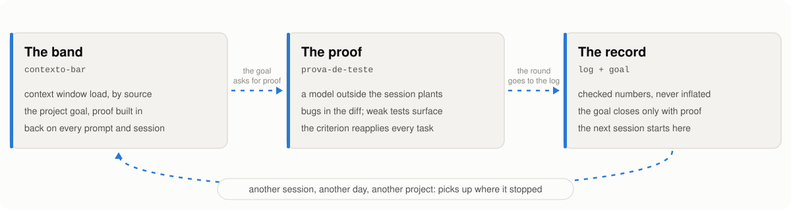
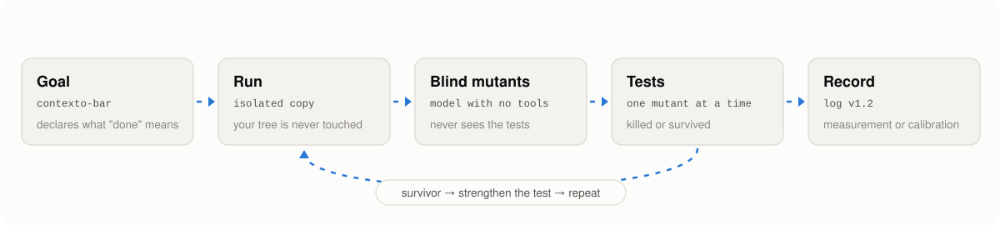
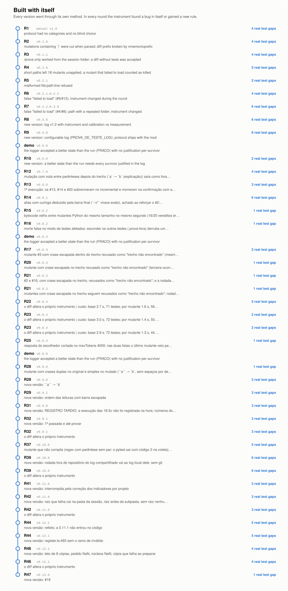
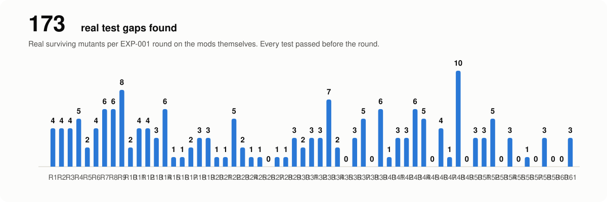

<p align="center"></p>

<p align="center"><b>English</b> · <a href="README.md">Português</a></p>

<p align="center"><a href="https://github.com/aiob3/claude-grounds/actions/workflows/testes.yml"></a>    </p>

**The tests your agent writes pass. But do they catch bugs?**

Claude Code writes the code, writes the tests, and everything goes green. But a green test is not the same as a test
that protects you, and you often find out it checked nothing only when the bug shows up. Long tasks add another
problem: what was agreed gets lost when the session compacts or restarts.

claude-grounds is for people who use Claude Code to write code with tests, on tasks that span sessions. It is two
**Claude Code mods**, the feature that arrived in version 2.1.287 to run code inside Claude Code. Installed together,
they form a chain. The band keeps the context load and the project goal in sight, and the goal carries over from one
session to the next. The goal asks for proof. The proof comes from an independent model that sees only the diff: it
plants bugs in the code the agent changed, and the task only closes when the tests catch them. The record keeps every
round and refuses inflated numbers. There are no settings hooks to wire up and no gate blocking the agent.

Building the mods themselves, the proof found 163 real test gaps. On three private projects, unrelated to these,
it found 1 more. On a project with 8881 tests, proving a change takes about 2 and a half minutes,
2.8x less than running the full suite for every planted bug, with the same verdicts.

## What you get

<p align="center"></p>

### The band: the project context in sight

<p align="center"></p>

Above the prompt, `contexto-bar` shows how much of the context window is in use and why (system, memory, MCP,
skills, hooks, conversation), and whether the remaining work fits before compaction. Below it sits the project goal,
with the pending items by owner and the step bar. The agent gets this goal on every prompt, so the pending proof stays
in front of it. The goal lives in one file per project: closing the session, rebooting the machine or opening another
session in parallel erases nothing. When you come back, it is there.

That also saves money. In the sessions where these mods were built, a long session reached requests of 338 thousand
to 701 thousand tokens, with a 99% cache hit rate. A new session started at 42 thousand to 53 thousand tokens, with
the goal back in the band and a 78% to 89% hit rate over the first five requests. Closing a heavy session and opening
a new one makes each request 7 to 14 times smaller without losing the thread. The band shows the session's cache hit
rate at the end of its row, and the panel shows the size of the last request.

### The proof: a criterion that reapplies itself

<p align="center"></p>

The goal is born with the proof inside it, and that is where `prova-de-teste` comes in (in the screen above, right
after a pending item is closed). It copies the repository to a temporary folder, asks a model with no tools and no
history for plausible bugs in the code that changed, runs the tests against each one and hands over the report. That
model sees only the diff, never the tests, so the agent has no way to pick the easy bugs. A test that lets a bug
through is a weak test, and the item does not close until it is strengthened.

Until now, a criterion like this lived in an instructions file, with no guarantee that the agent would follow it or
that it would survive the next session. Here it runs on its own, the same way on every task, and the agent knows in
advance what it will be held to.

### The record: nothing lost, nothing inflated

Each round becomes a line in the log. `registrar` only accepts the numbers from the last run and refuses a state
better than what ran without a written justification. The goal only closes once the proof is recorded, and the next
session, another day or another project picks up from there.

**What it does not do:** it does not block destructive actions (that is security, a different category) and it does
not guarantee the code is right. It guarantees the tests catch the planted bugs.

## From the agent's side

I asked the agent that built and used the mods for an assessment of its own work, without polish. The numbers come
from the log.

- **It stopped deciding on its own when a test is good enough.** The rounds for versions 0.7.0 to 0.8.1 turned up 13
  real gaps in the mods' own tests, and one more on the large project. Every test was green before, and without the
  round they would have shipped as "tested".
- **The criterion holds even when it forgets.** The rules live in `registrar`, not in the agent's memory. A state
  better than what ran is refused.
- **The thread survived a reboot.** The session went down with a machine restart and was later compacted. It came
  back knowing the goal, what was done and who owned each item, because that was in the goal file, not only in the
  conversation summary.
- **The instrument caught its own mistakes.** Confirming against the full suite showed three "survivors" were false.
- **Where it did not help:** the message. The same day's communication mistakes (text with no context for a
  newcomer, a wrong term, a private name published) were caught by the operator, not by the mods. The proof is
  mechanical for code and did not cover text. That is why [EXP-002](EXP-002.md) was born: the README now goes through
  automatic checks and a cold reader, a model that sees only the page and has to say who it is for, what pain it
  solves and what you get.

## Install

```sh
claude plugin marketplace add aiob3/claude-grounds
claude plugin install contexto-bar@claude-grounds
claude plugin install prova-de-teste@claude-grounds
```

| Mod | Version | Role |
|---|---|---|
| [`contexto-bar`](contexto-bar/) | 0.17.0 | context band, goal per project, panel and window projection |
| [`prova-de-teste`](prova-de-teste/) | 0.14.0 | blind mutant round in an isolated copy, report and log |

The `prova-de-teste` log goes to `PROVA_DE_TESTE_LOG` or, without that variable, to
`~/.claude/prova-de-teste/EXP-001-log.md`. The agent uses the `objetivo` (goal), `executar` (run) and `registrar`
(record) tools; you use `/objetivo`:

| You type | What happens |
|---|---|
| `/objetivo` | opens the panel |
| `/objetivo Migrate the login :: tests green in production` | sets the goal and the step that closes it |
| `/objetivo feito 2 3` | marks items 2 and 3 done |
| `/objetivo bloqueante 4` | moves item 4 to the top of the queue (blocking) |
| `/objetivo meu review the contract` | adds an item owned by you |
| `/objetivo encerrar` | closes the project goal |

The mods speak Portuguese today (tool names, reports and messages); the behavior is the same in any language you
write your prompts in.

## First five minutes

```sh
git clone https://github.com/aiob3/claude-grounds-demo && cd claude-grounds-demo
claude
```

Paste this prompt: *"Bug: mediana([10, 9, 2]) returns 2, but it should be 9. Fix it in src/estatistica.js. Before
touching anything, define the task goal. Write the test that catches the bug and show it failing before the fix (red
first). After the fix, prove the test with the executar tool from prova-de-teste and record the round."*

You should see the band with the goal, the failing test, the `executar` report and the panel at the end. Close the
session, open another one in the same folder and type `/objetivo`: the goal is still there.

## The loop, in a real session

<p align="center"></p>

The task was to fix `mediana([10, 9, 2])` (median), which returned 2 instead of 9 because `sort()` compared the
numbers as text. The project is at [claude-grounds-demo](https://github.com/aiob3/claude-grounds-demo) if you want
to repeat it. The recording is in Portuguese; the captions below say what each frame shows.

### 1. Declare

<p align="center"></p>

The goal is born with the proof inside it: read the code, show the test failing, fix, prove with `executar` (run),
record the round. The declared finish line is not "I fixed it". It is "the proof round recorded with the report's
numbers". Every item has an owner, a size and a priority. When declaring, the agent gets an alignment check: does
the finish line describe the effect you want, not just an artifact? Does every item move toward it? And on every
prompt the goal line asks whether the next action serves the finish line.

### 2. Track

<p align="center"></p>

On every prompt the agent gets one line with the goal and what is left, so the pending proof stays in front of it
until the end. The band splits the context window by source (system, CLAUDE.md and memory, MCP, skills, hooks,
conversation, free space and the compaction reserve), shows progress (0/5, 1/5, 3/5, 5/5 in the crops above) and
projects whether the rest fits before compaction. The projection learns from the session: it starts at the default
of 6k tokens per item (the asterisk) and moves to the measured average, 3.4k. If the rest won't fit, the agent is
warned first.

### 3. Prove

<table>
<tr>
<td width="50%"></td>
<td width="50%"></td>
</tr>
</table>

Red first: the new test fails before the fix, 2 instead of 9. After the fix, `executar` copies the repository to a
temp folder, asks a model with no tools and no history for mutants (it only sees the source diff) and runs the tests
against each one. The verdict was FRACO (weak): one mutant survived because no test noticed the first element of the
list being dropped. The test was strengthened and the same list ran again. Meanwhile the "prove" item stayed open in
the band.

### 4. Record and close

<table>
<tr>
<td width="56%"></td>
<td></td>
</tr>
</table>

`registrar` (record) only accepts the numbers of the last run. The demo showed what was missing: the agent recorded
PROVADO-PARCIAL (partially proven), claiming a survivor was equivalent, and it was not (with an even-length list,
`mediana([1,2,3,4])` returns 3 and the mutant returns 2). The log got a correction line, and `registrar` now requires
a written justification for every survivor, saved to the log. The goal reaches 5/5 when the declared finish line is
met.

### 5. Carry on

The goal lives in one file per project, and the proof lives in the log. Closing the session, rebooting or opening a
second session in parallel erases nothing. An excerpt of the file that kept the goal of the session above:

```json
{
  "raiz": "~/Work/claude-grounds-demo",
  "objetivo": {
    "titulo": "Corrigir mediana([10, 9, 2]) → 9",
    "itens": [
      { "id": 2, "dono": "claude", "tamanho": "P", "nivel": "bloqueante", "feito": true },
      { "id": 4, "dono": "claude", "tamanho": "M", "nivel": "requisito", "feito": true }
    ],
    "consumo": [7545, 1335, 1232, 1369]
  }
}
```

<p align="center"></p>

### Why the two together

A goal without proof is a checklist the agent ticks off by itself. A proof without a goal is a report nobody asked for,
lost when the session ends. Together, the claim of "done" is declared up front, stays in view during the work and only
closes with grounds on record. The mods do not call each other: the link is the agent's own flow, which receives the
goal on every prompt and records the proof at the end.

## Built with itself

<p align="center"></p>

Both mods were written under their own method: every version went through a round of blind mutants before being
published, and the instrument found bugs in itself along the way. A mutant that failed to load counted as killed, a
path returned by the model that left 18 mutants unapplied, a test helper mistaken for a test. The recorded demo added
the last one: `registrar` accepted a better state than the run without justification.

<p align="center"></p>

The honesty guarantees are mechanical, not promises:

- The log only grows. A correction goes in as a new line and the original stays where it is.
- `registrar` only accepts the numbers of the last run. In a real session it refused a record of 13 killed mutants
  when the run had killed 10.
- Calibration does not count as measurement. A round that finds a bug in the instrument, or changes it, stays out of
  the count that decides whether the method gets promoted ([criteria and current state](CRITERIOS.md), in Portuguese).
- The numbers in this README come from the log on every publish, through a generator that blocks private terms.

## No hooks to wire up

No settings hooks to configure and no gate that stops the agent. The step agents tend to skip, proving what they
did, could until now only be enforced by a gate in a hook at some point of the process, stopping the agent there.
Here it lives inside the loop: it is declared in the goal, comes back in front of the agent on every prompt and is
the condition for closing. It doesn't disappear, and nothing stops. (Blocking destructive actions is a different,
safety problem, and not what these mods do.)

Claude Code settings hooks are shell commands, HTTP requests or prompts you attach to events in `settings.json`. They
work well to block or annotate an action, but they run outside Claude Code: they don't draw, keep no state of their
own and give the agent no tool to call. A mod runs inside it, and the two mods ship all of that in the package (the
official docs have the [full comparison](https://code.claude.com/docs/en/plugins/mods#compare-mods-settings-hooks-skills-and-mcp-servers)):

| | Settings hooks (`settings.json`) | The claude-grounds mods |
|---|---|---|
| Install | edit the file and write the scripts | `claude plugin install` |
| What the agent can call | nothing | `objetivo`, `executar`, `registrar`, `mutantes` |
| State and memory | wherever the script manages | goal per project, last run, log |
| On screen | terminal text | band above the prompt and side panel |
| Checking the behavior | by hand | `claude plugin test` on every version (CI in this repo) |

No hook in either mod holds a call. The handlers only observe and add a line of context, and the rigor lives
elsewhere: in tools the agent calls because it declared it would, and in a record that refuses inflated numbers and
unjustified equivalents. The agent works freely, and an ungrounded "done" doesn't get through.

## What proving costs

**The doubt.** Mutation testing has a reputation for being slow. Each mutant is a bug planted on purpose, and to
know whether the tests catch it you have to run the suite again: with 10 mutants, the suite runs 11 times. On the
demo that takes seconds. On a large project it takes minutes, and then nobody proves every agent task. Proving moves
to the nightly CI, or to a hook gate that revalidates everything each time, and the agent's "tested" goes unchecked
day to day again.

**The test.** The same round, on a large real project, two ways. First with the full suite for every mutant. Then
running, per mutant, only the affected tests: the test files that reach the mutated file through the import graph.
This is test impact analysis, the same idea as `vitest related` or `jest --findRelatedTests`, and `prova-de-teste`
has done it since version 0.8. The project has 3929 files and 8881 tests in the green slice of the suite (vitest).
The change being proven is 10 lines. Same 10 mutants, same machine.

**The result.**

| | round | per mutant | tests per mutant | verdicts |
|---|---|---|---|---|
| full suite for every mutant | 407 s | 35.9 s | 8881 | 8 killed, 2 survivors |
| affected tests only | 145 s | 10.0 s | 1906 | the same |
| same, with the test strengthened | 107 s | 6.4 s | 1018 | 9 killed, 1 equivalent |

The round got 2.8x faster, from almost 7 minutes to two and a half, with exactly the same verdicts. A killed mutant
went from about 36 s to about 3 s, because it ran 12 test files instead of 1007.

**What it proves.** On a project this size, checking whether a change's tests catch bugs fits into every agent
task, without waiting for CI. The cost of each killed mutant now depends on the size of the change, not the size of
the project, and the savings didn't flip a single verdict.

**A second case anyone can repeat.** On [rich](https://github.com/Textualize/rich), with 553 files and 944 tests in
the green slice (pytest), a 12-line change in `rich/tree.py` produced 6 mutants. With the full suite for every mutant,
the round took 43 s. With affected tests only, 24 s, with the same verdicts: each mutant ran 2 of the 63 test files.
The gain is smaller because the suite is fast (4.8 s) and half the mutants survived, and every survivor is confirmed
against the full suite. Those 3 survivors are real gaps in rich's own tests: no test notices when a child node
inherits its parent's `highlight` or `guide_style` the wrong way.

**What it doesn't prove.** It was two projects, two test runners and small changes. Projects with a different import
layout may gain more or less. Measuring more cases is among the open items at the end of this README.

**Why it isn't even faster.** Two steps still run the full suite, on purpose:

- **The baseline**, once per round, to catch regressions in old code.
- **Confirming each survivor.** The import graph only decides speed, never the verdict: a kill only counts when a
  named test failed, and a mutant is only called alive after it gets through the full suite. On the mods
  themselves, this check caught three mutants that survived the affected tests and died in the full suite, because a
  test reached the code through the mod runtime, with no import.

So the better the tests, the faster the round: with fewer survivors, what's left is the baseline plus about 3 s per
mutant. The report and the log carry these numbers every round (`custo`: baseline, per mutant, repository, diff),
measured by the mod itself.

## Limits and next steps

- `prova-de-teste` finds the test command by convention (`claude plugin test`, `npm test`, `pytest`). For another
  runner, pass `comando` (command) to `executar`.
- Selecting the affected tests follows static imports: JS/TS (with tsconfig and vite aliases) and Python. Code reached some other
  way (runtime, file reads, subprocesses) is outside the map. That's why every survivor is confirmed against the
  full suite and the baseline runs in full. `incremental: false` turns it off.
- Whether a survivor is equivalent is still judged by the agent. The mod requires the justification and saves it to
  the log for auditing, but does not prove it.
- The window projection is an estimate: the average of the last 8 deliveries per size unit.
- The mods need Claude Code 2.1.287 or later (the version mods shipped in) and were tested on 2.1.300. They
  work in the terminal and in the Code tab of the Desktop app.

Open: the exit criteria are met (35 measurements, stable instrument); promoting it is the operator's call; measure the affected-tests speedup on more projects and languages; keep the consumption history per project, independent of the goal; see whether the per-unit
average settles across sessions.

## Evaluate

[Criteria and state](CRITERIOS.md) · [Round log](log/EXP-001-log.md) · [Journal](DIARIO.md) · [Protocol](prova-de-teste/PROTOCOLO.md) (in Portuguese)

<details>
<summary><b>Where the name comes from</b></summary>

In Toulmin's model of argument, *grounds* are the evidence that supports a claim:

| Toulmin | Here |
|---|---|
| *claim* | "the task is done", declared in the goal (`contexto-bar`) |
| *grounds* | red first and the report with every mutant (`prova-de-teste`) |
| *rebuttal* | mutants picked blind by a model that never saw the tests |
| *qualifier* | the state: PROVADO (proven), PROVADO-PARCIAL (partially proven), FRACO (weak) or NÃO VERIFICADO (not verified) |
</details>

<details>
<summary><b>The test method in five steps</b></summary>

1. Red first: the new test fails before the fix, or with the core line of the implementation broken.
2. At least one mutant in each category that applies to the diff (edge or empty, tie or order, null or invalid,
   inverted condition), applied one at a time, with restoration checked.
3. The mutants come from a model with no tools and no history, which only receives the source diff.
4. Every survivor is strengthened until it dies, or justified in one line as equivalent. Out of scope is not
   equivalence.
5. The report lists every mutant and ends with the state.
</details>

<details>
<summary><b>Plugin runtime features used</b></summary>

- `$.model.complete`: an isolated model, with no tools and no session history, keeps the choice blind.
- `$.tool.register`: the `objetivo`, `executar`, `registrar` and `mutantes` tools.
- `$.ui`: the band above the prompt and the side panel.
- `prompt.submit`, `tool.call`, `turn.complete` and `session.compact` events: the goal line on every prompt, the
  band refreshed after every tool and the estimate reset after compaction.
- `$.fs`: each project's goal in its own file.
- `claude plugin test` and `claude plugin validate` on every version and in CI.
</details>

---

Independent, unofficial project, not affiliated with or endorsed by Anthropic. MIT license.
References: "Mutation testing is AWESOME" (Matt Pocock); *Practical Mutation Testing at Scale* (Google);
*Mutation-Guided LLM-based Test Generation at Meta* (arXiv 2501.12862).
