<p align="center"></p>

<p align="center"><a href="README.en.md">English</a> · <b>Português</b></p>

<p align="center"><a href="https://github.com/aiob3/claude-grounds/actions/workflows/testes.yml"></a>    </p>

**Os testes que o agente escreve passam. Mas pegam bug?**

O Claude Code escreve o código, escreve os testes, e tudo fica verde. Só que teste verde não quer dizer teste que
protege, e muitas vezes você só descobre que ele não conferia nada quando o bug aparece. Em tarefa longa ainda há
outro problema: o combinado se perde quando a sessão compacta ou recomeça.

O claude-grounds é para quem usa o Claude Code para escrever código com testes, em tarefas que atravessam sessões.
São dois **mods do Claude Code**, o recurso que chegou na versão 2.1.287 para rodar código dentro dele. Instalados
juntos, formam uma cadeia. A faixa deixa à vista a carga de contexto e o objetivo do projeto, que passa de uma
sessão para a outra. O objetivo pede a prova. A prova é feita por um modelo independente, que vê só o diff: ele
planta bugs no código que o agente mudou, e a tarefa só fecha quando os testes pegam. O registro guarda cada rodada
e recusa número inflado. Não há settings hook para configurar nem gate travando o agente.

Construindo os próprios mods, a prova achou 170 falhas reais de teste. Em três projetos privados, sem relação com
estes, achou mais 1. Num projeto com 8881 testes, provar uma mudança leva uns 2 minutos e meio,
2,8 vezes menos que rodar a suíte completa para cada bug plantado, com os mesmos vereditos.

## O que você ganha

<p align="center">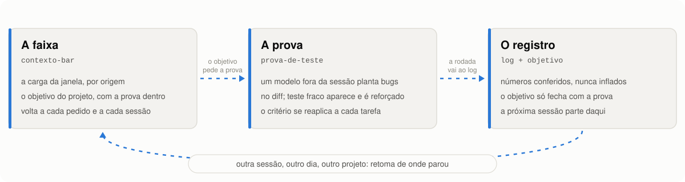</p>

### A faixa: o contexto do projeto à vista

<p align="center">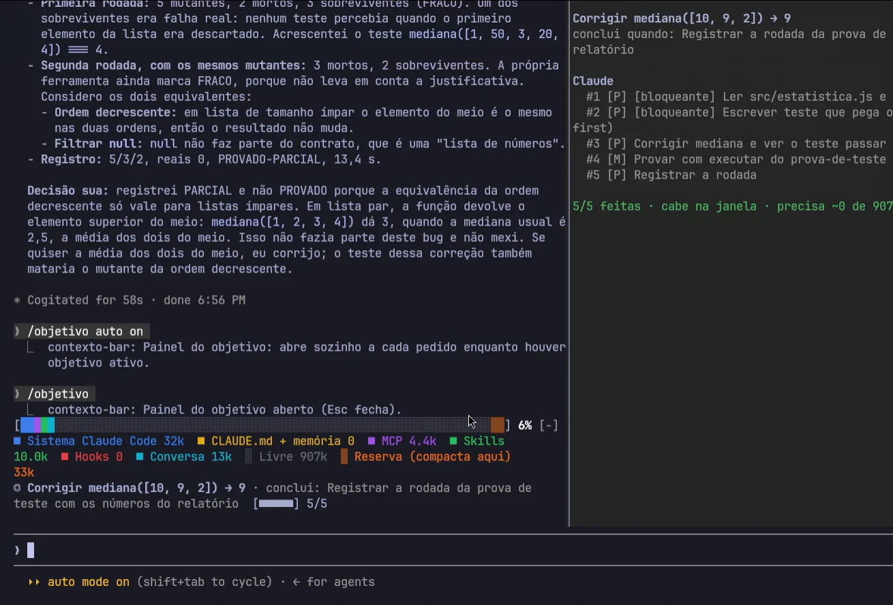</p>

Acima do prompt, o `contexto-bar` mostra quanto da janela de contexto está ocupado e por quê (sistema, memória,
MCP, skills, hooks, conversa), e se o que falta fazer cabe antes da compactação. Embaixo vem o objetivo do projeto,
com as pendências por dono e a barra de etapas. O agente recebe esse objetivo a cada pedido, então a prova pendente
não sai da frente dele. O objetivo fica num arquivo por projeto: fechar a sessão, reiniciar a máquina ou abrir outra
sessão em paralelo não apaga nada. Na volta, ele está lá.

Isso também é economia. Nas sessões em que estes mods foram construídos, uma sessão longa chegou a pedidos de 338 mil
a 701 mil tokens, com 99% de acerto no cache. Uma sessão nova começou com 42 mil a 53 mil tokens, o objetivo de volta
na faixa e, nos cinco primeiros pedidos, de 78% a 89% de acerto. Fechar uma sessão pesada e abrir outra deixa cada
pedido de 7 a 14 vezes menor, sem perder o fio. A faixa mostra o acerto do cache da sessão no fim da linha, e o
painel, o tamanho do último pedido.

### A prova: o critério que se reaplica sozinho

<p align="center">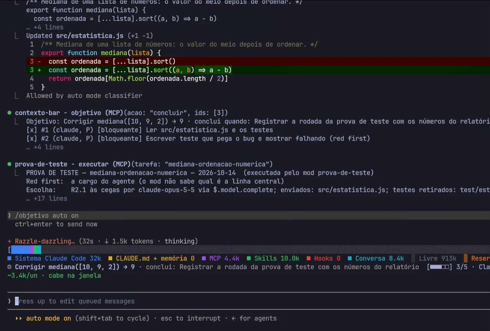</p>

O objetivo nasce com a prova dentro, e é aí que o `prova-de-teste` entra (na tela acima, logo depois de uma
pendência concluída). Ele copia o repositório para uma pasta temporária, pede a um modelo sem ferramentas e sem
histórico bugs plausíveis para o código que mudou, roda os testes contra cada um e entrega o relatório. Esse modelo vê
só o diff, nunca os testes, então o agente não tem como escolher os bugs fáceis. Teste que deixa um bug passar é
teste fraco, e a pendência não fecha até ele ser reforçado.

Até aqui, um critério assim ficava escrito num arquivo de instruções, e ninguém garantia que o agente o seguiria nem
que ele sobreviveria à próxima sessão. Aqui ele roda sozinho, do mesmo jeito em toda tarefa, e o agente sabe de
antemão o que vai ser cobrado.

### O registro: nada se perde, nada infla

Cada rodada vira uma linha no log. O `registrar` só aceita os números da última execução e recusa estado melhor que o
executado sem justificativa escrita. O objetivo só fecha quando a prova está registrada, e a próxima sessão, outro dia
ou outro projeto retoma dali.

**O que ele não faz:** não bloqueia ações destrutivas (isso é segurança, outra categoria) e não garante que o código
está certo. Garante que os testes pegam os bugs plantados.

## Do lado do agente

Pedi ao agente que construiu e usou os mods uma avaliação do próprio trabalho, sem enfeite. Os números saem do log.

- **Ele deixou de decidir sozinho quando um teste está bom.** Nas rodadas das versões 0.7.0 a 0.8.1 apareceram 13
  falhas reais nos testes dos próprios mods, e mais uma no projeto grande. Todos os testes estavam verdes antes, e
  sem a rodada teriam sido entregues como "testado".
- **O critério vale mesmo quando ele esquece.** As regras estão no `registrar`, não na memória do agente. Um estado
  melhor que o executado é recusado.
- **O fio não se perdeu nem com a máquina reiniciada.** A sessão caiu num reboot e depois foi compactada. Ela voltou
  sabendo o objetivo, o que estava feito e de quem era cada pendência, porque isso estava no arquivo do objetivo, e
  não só no resumo da conversa.
- **O instrumento pegou erros dele mesmo.** A confirmação na suíte completa mostrou que três "sobreviventes" eram
  falsos.
- **Onde não ajudou:** na mensagem. Os erros de comunicação do mesmo dia (texto sem contexto para quem chega, termo
  errado, um nome privado publicado) foram pegos pelo operador, não pelos mods. A prova é mecânica para código e não
  cobria o texto. Por isso nasceu o [EXP-002](EXP-002.md): o README agora passa por checagens automáticas e por um
  leitor frio, um modelo que só vê a página e precisa dizer para quem ela é, que dor resolve e o que se ganha.

## Instalar

```sh
claude plugin marketplace add aiob3/claude-grounds
claude plugin install contexto-bar@claude-grounds
claude plugin install prova-de-teste@claude-grounds
```

| Mod | Versão | Papel |
|---|---|---|
| [`contexto-bar`](contexto-bar/) | 0.19.0 | faixa de contexto, objetivo por projeto, painel e projeção da janela |
| [`prova-de-teste`](prova-de-teste/) | 0.15.0 | rodada de mutantes às cegas numa cópia isolada, relatório e log |

O log do `prova-de-teste` vai para `PROVA_DE_TESTE_LOG` ou, sem essa variável, para
`~/.claude/prova-de-teste/EXP-001-log.md`. O agente usa as ferramentas `objetivo`, `executar` e `registrar`; você usa
o `/objetivo`:

| Você digita | O que acontece |
|---|---|
| `/objetivo` | abre o painel |
| `/objetivo Migrar o login :: testes verdes em produção` | define o objetivo e o passo que o encerra |
| `/objetivo feito 2 3` | conclui as pendências 2 e 3 |
| `/objetivo bloqueante 4` | sobe a pendência 4 para o topo da fila |
| `/objetivo meu revisar o contrato` | acrescenta uma pendência sua |
| `/objetivo encerrar` | encerra o objetivo do projeto |

## Primeiros cinco minutos

```sh
git clone https://github.com/aiob3/claude-grounds-demo && cd claude-grounds-demo
claude
```

Cole o pedido da gravação: *"Bug: mediana([10, 9, 2]) devolve 2, mas o certo é 9. Corrija em src/estatistica.js.
Antes de mexer, defina o objetivo da tarefa. Escreva o teste que pega o bug e mostre ele falhando antes da correção
(red first). Depois da correção, prove o teste com a ferramenta executar do prova-de-teste e registre a rodada."*

Você deve ver a faixa com o objetivo, o teste falhando, o relatório do `executar` e o painel no fim. Feche a sessão,
abra outra na mesma pasta e digite `/objetivo`: o objetivo continua lá.

## O ciclo, numa sessão real

<p align="center">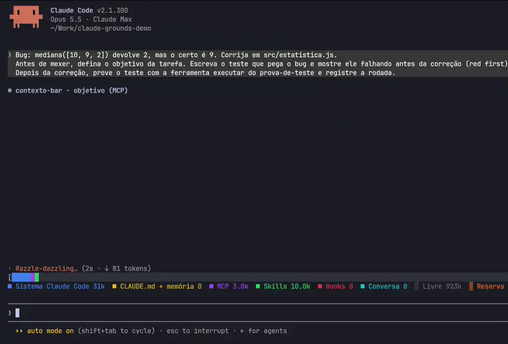</p>

O pedido era corrigir `mediana([10, 9, 2])`, que devolvia 2 em vez de 9 porque `sort()` ordenava os números como
texto. O projeto está em [claude-grounds-demo](https://github.com/aiob3/claude-grounds-demo) para quem quiser repetir.

### 1. Declarar

<p align="center">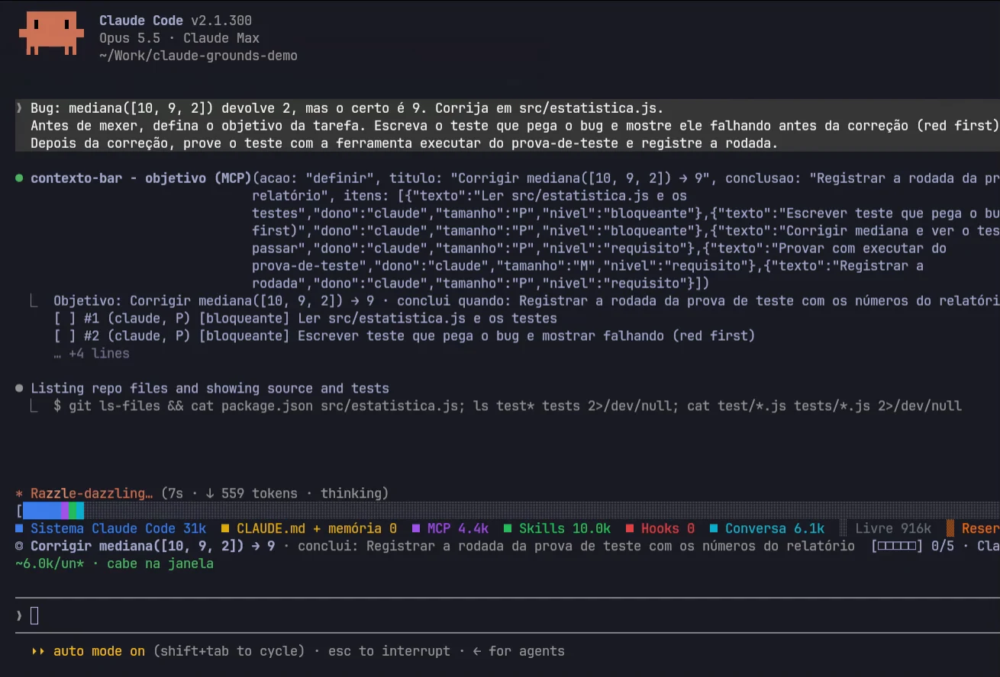</p>

O objetivo nasce com a prova dentro dele: ler o código, mostrar o teste falhando, corrigir, provar com o
`executar`, registrar a rodada. A conclusão declarada não é "corrigi". É "a rodada de prova registrada com os
números do relatório". Cada pendência tem dono, tamanho e prioridade. Ao declarar, o agente recebe uma checagem
de alinhamento: a conclusão descreve o efeito que se quer, e não só um artefato? Cada pendência aproxima dela? E a
cada pedido a linha do objetivo pergunta se a próxima ação serve à conclusão.

### 2. Acompanhar

<p align="center">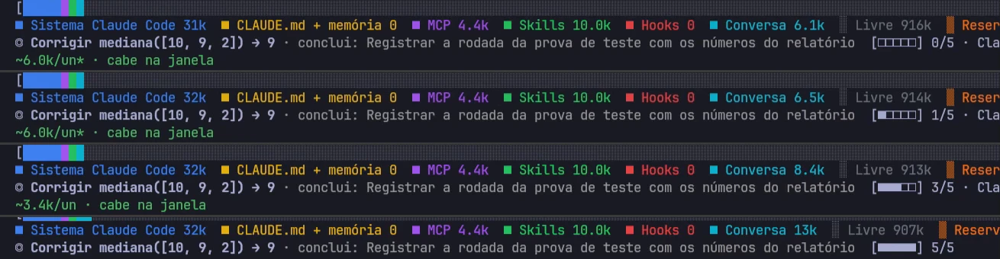</p>

A cada pedido, o agente recebe uma linha com o objetivo e o que falta, então a prova pendente fica na frente dele
até o fim. A faixa divide a janela de contexto por origem, mostra o progresso (0/5, 1/5, 3/5, 5/5 nos recortes
acima) e projeta se o restante cabe antes da compactação. A projeção aprende com a sessão: começa no padrão de 6k
tokens por item (o asterisco) e passa à média medida, 3,4k. Se não couber, o agente é avisado antes.

### 3. Provar

<table>
<tr>
<td width="50%">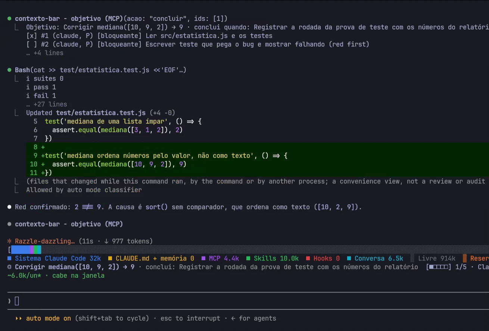</td>
<td width="50%">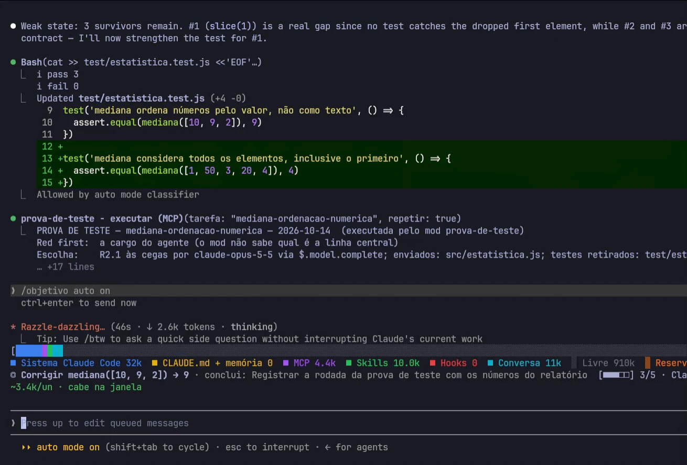</td>
</tr>
</table>

Primeiro o red first: o teste novo falha antes da correção, 2 em vez de 9. Depois da correção, o `executar` copia o
repositório para uma pasta temporária, pede mutantes a um modelo sem ferramentas e sem histórico, que só vê o diff
do código, e roda os testes contra cada um. Deu FRACO: um mutante sobreviveu porque nenhum teste via o primeiro
elemento da lista. O teste foi reforçado e a mesma lista rodou de novo. Enquanto isso, a pendência "provar" seguia
aberta na faixa.

### 4. Registrar e fechar

<table>
<tr>
<td width="56%">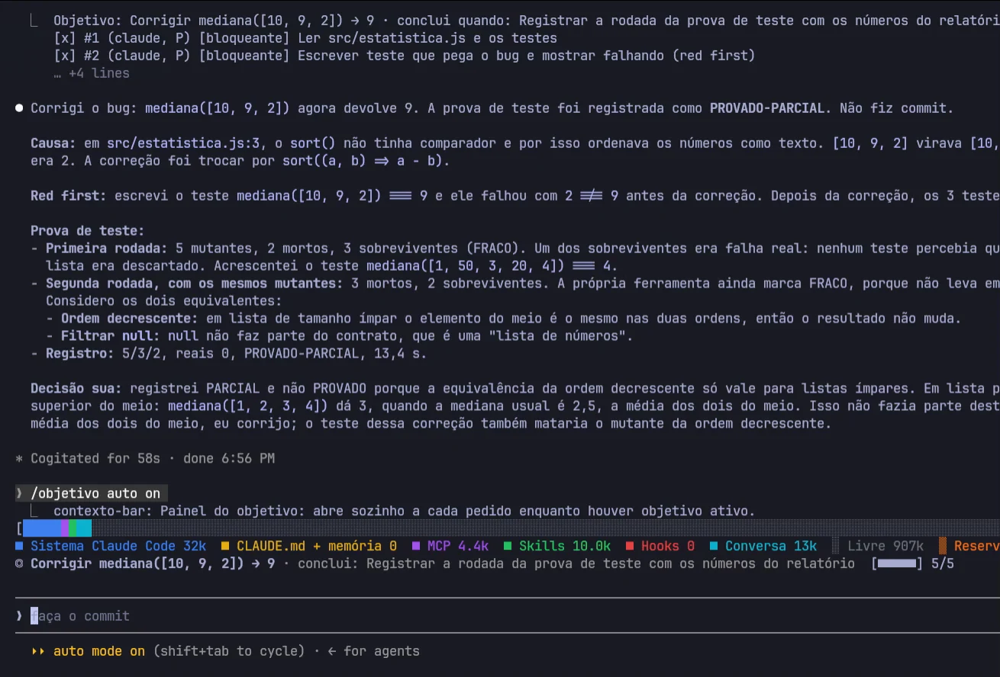</td>
<td>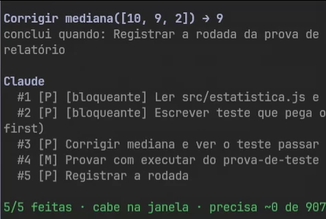</td>
</tr>
</table>

O `registrar` só aceita os números da última execução. A demo mostrou o que faltava: o agente registrou
PROVADO-PARCIAL alegando que um sobrevivente era equivalente, e não era (com lista par, `mediana([1,2,3,4])` dá 3 e
o mutante dá 2). O log ganhou uma linha de correção, e o `registrar` passou a exigir a justificativa escrita de cada
sobrevivente, gravada no log. O objetivo chega a 5/5 quando a conclusão declarada se cumpre.

### 5. Continuar

O objetivo fica num arquivo por projeto, e a prova fica no log. Fechar a sessão, reiniciar a máquina ou abrir outra
sessão em paralelo não apaga nada. Um trecho do arquivo que guardou o objetivo da sessão acima:

```json
{
  "raiz": "~/Work/claude-grounds-demo",
  "objetivo": {
    "titulo": "Corrigir mediana([10, 9, 2]) → 9",
    "itens": [
      { "id": 2, "dono": "claude", "tamanho": "P", "nivel": "bloqueante", "feito": true },
      { "id": 4, "dono": "claude", "tamanho": "M", "nivel": "requisito", "feito": true }
    ],
    "consumo": [7545, 1335, 1232, 1369]
  }
}
```

<p align="center">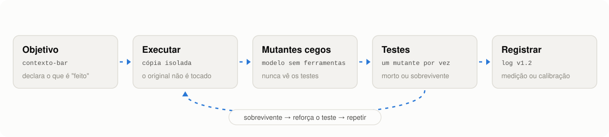</p>

### Por que os dois juntos

Um objetivo sem prova é uma lista que o agente marca como feita sozinho. Uma prova sem objetivo é um relatório que
ninguém pediu e que se perde quando a sessão acaba. Juntos, a afirmação de "pronto" vem declarada antes, fica à
vista durante o trabalho e só fecha com fundamento registrado. Os mods não chamam um ao outro: o elo é o próprio
fluxo do agente, que recebe o objetivo a cada pedido e registra a prova no fim.

## Construído com ele mesmo

<p align="center">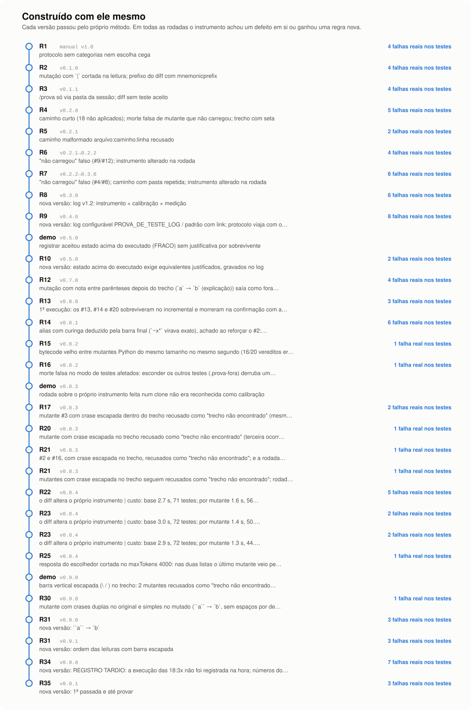</p>

Os dois mods foram escritos sob o próprio método: cada versão passou por uma rodada de mutantes escolhidos às cegas
antes de ser publicada, e o instrumento achou defeitos em si mesmo pelo caminho. Um mutante que não carregava contado
como morto, um caminho devolvido pelo modelo que fazia 18 mutantes não serem aplicados, um helper de teste tomado por
teste. A demo gravada acrescentou o último da lista: o `registrar` aceitava um estado melhor que o executado sem
justificativa.

<p align="center">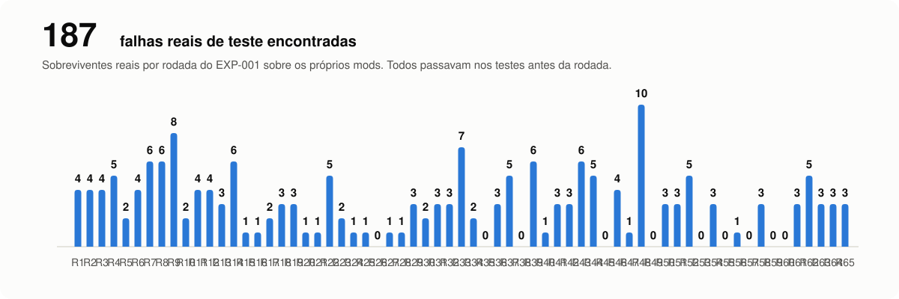</p>

As garantias de honestidade são mecânicas, não promessas:

- O log só cresce. Uma correção entra como linha nova e a original fica onde está.
- O `registrar` só aceita os números da última execução. Numa sessão real, ele recusou um registro de 13 mutantes
  mortos quando a execução tinha matado 10.
- Calibração não conta como medição. Rodada que acha defeito do instrumento, ou que o altera, fica fora da conta que
  decide se o método será promovido ([critérios e estado atual](CRITERIOS.md)).
- Os números deste README saem do log a cada publicação, por um gerador que barra termos privados.

## Sem hooks para configurar

Sem settings hooks para configurar e sem gate que trave o agente. A etapa que o agente costuma pular, provar o que
fez, até agora só era garantida com um gate num hook, em algum ponto do processo, travando o agente ali. Aqui ela
entra no próprio ciclo: é declarada no objetivo, volta à frente do agente a cada pedido e é a condição para fechar.
Não some, e nada trava. (Impedir ações destrutivas é outro problema, de segurança, e não é o que estes mods fazem.)

Os settings hooks do Claude Code são comandos de shell, chamadas HTTP ou prompts que você liga a eventos no
`settings.json`. Funcionam bem para bloquear ou anotar uma ação, mas rodam fora do Claude Code: não desenham na
tela, não guardam estado próprio e não dão ao agente uma ferramenta para chamar. Um mod roda dentro dele, e os dois
mods trazem tudo isso no pacote (a documentação oficial tem a [comparação completa](https://code.claude.com/docs/en/plugins/mods#compare-mods-settings-hooks-skills-and-mcp-servers)):

| | Settings hooks (`settings.json`) | Os mods do claude-grounds |
|---|---|---|
| Instalar | editar o arquivo e escrever os scripts | `claude plugin install` |
| O agente pode chamar | nada | `objetivo`, `executar`, `registrar`, `mutantes` |
| Estado e memória | o script guarda onde conseguir | objetivo por projeto, última execução, log |
| Na tela | texto no terminal | faixa acima do prompt e painel lateral |
| Verificar o comportamento | à mão | `claude plugin test` em cada versão (CI neste repositório) |

Nenhum hook dos dois mods segura uma chamada. Os handlers só observam e acrescentam uma linha de contexto, e o rigor está em
outro lugar: nas ferramentas que o agente chama porque declarou que chamaria, e num registro que recusa número
inflado e equivalente sem justificativa. O agente trabalha livre, e o "pronto" sem fundamento não passa.

## Quanto custa provar

**A dúvida.** Mutation testing tem fama de lento. Cada mutante é um bug plantado de propósito, e para saber se os
testes o pegam é preciso rodar a suíte de novo: com 10 mutantes, a suíte roda 11 vezes. Na demo isso leva segundos.
Num projeto grande leva minutos, e aí ninguém prova a cada tarefa do agente. A prova vai para o CI noturno, ou para
um gate num hook que revalida tudo a cada vez, e o "testado" do agente volta a ficar sem conferência no dia a dia.

**O teste.** A mesma rodada, num projeto real grande, de dois jeitos. Primeiro com a suíte completa para cada
mutante. Depois rodando, por mutante, só os testes afetados: os arquivos de teste que chegam ao arquivo mutado pelo
grafo de imports. É test impact analysis, a mesma ideia do `vitest related` e do `jest --findRelatedTests`, e o
`prova-de-teste` faz isso desde a versão 0.8. O projeto tem 3929 arquivos e 8881 testes no recorte verde da suíte
(vitest). A mudança provada tem 10 linhas. Foram os mesmos 10 mutantes, na mesma máquina.

**O resultado.**

| | rodada | por mutante | testes por mutante | vereditos |
|---|---|---|---|---|
| suíte completa em cada mutante | 407 s | 35,9 s | 8881 | 8 mortos, 2 sobreviventes |
| só os testes afetados | 145 s | 10,0 s | 1906 | os mesmos |
| idem, com o teste reforçado | 107 s | 6,4 s | 1018 | 9 mortos, 1 equivalente |

A rodada ficou 2,8 vezes mais rápida, de quase 7 minutos para 2 e meio, com exatamente os mesmos vereditos. Um
mutante morto passou de uns 36 s para uns 3 s, porque rodou 12 arquivos de teste em vez de 1007.

**O que isso prova.** Num projeto desse tamanho, conferir se os testes de uma mudança pegam bug cabe em cada tarefa
do agente, sem esperar o CI. O custo de cada mutante morto passou a depender do tamanho da mudança, não do tamanho
do projeto, e a economia não trocou nenhum veredito.

**Um segundo caso, que qualquer um pode repetir.** No [rich](https://github.com/Textualize/rich), com 553 arquivos e
944 testes no recorte verde (pytest), uma mudança de 12 linhas em `rich/tree.py` gerou 6 mutantes. Com a suíte
completa em cada mutante, a rodada levou 43 s. Só com os testes afetados, 24 s, com os mesmos vereditos: cada
mutante rodou 2 dos 63 arquivos de teste. O ganho é menor porque a suíte é rápida (4,8 s) e metade dos mutantes
sobreviveu, e cada sobrevivente é confirmado na suíte completa. Esses 3 sobreviventes são lacunas reais nos testes do
próprio rich: nenhum teste percebe quando um nó filho herda errado o `highlight` ou o `guide_style` do pai.

**O que não prova.** Foram dois projetos, dois executores de testes e mudanças pequenas. Em projetos com outro desenho
de imports o ganho pode ser maior ou menor. Medir mais casos está entre os pontos em aberto, no fim deste README.

**Por que não fica ainda mais rápido.** Duas etapas continuam rodando a suíte completa, de propósito:

- **A linha de base**, uma vez por rodada, para pegar regressão no código antigo.
- **A confirmação de cada sobrevivente.** O grafo de imports só decide a velocidade, nunca o veredito: uma morte só
  vale se um teste nomeado falhou, e um mutante só é dado como vivo depois de passar pela suíte completa. Nos
  próprios mods, essa confirmação pegou três mutantes que sobreviveram aos testes afetados e morreram na suíte
  completa, porque um teste chegava ao código pelo runtime do mod, sem import.

Por isso, quanto melhores os testes, mais rápida a rodada: com menos sobreviventes, sobra a linha de base mais uns
3 s por mutante. O relatório e o log trazem esses números a cada rodada (`custo: base, por mutante, repositório,
diff`), medidos pelo próprio mod.

## Limites e próximos passos

- O `prova-de-teste` acha o comando de teste por convenção (`claude plugin test`, `npm test`, `pytest`). Para outro
  executor, passe `comando` ao `executar`.
- A seleção dos testes afetados segue imports estáticos: JS/TS (com os aliases do tsconfig e do vite) e Python. O que chega
  ao código por outro caminho (runtime, leitura de arquivo, subprocesso) fica fora do mapa. Por isso todo
  sobrevivente é confirmado na suíte completa e a linha de base roda completa. `incremental: false` desliga.
- A equivalência de um sobrevivente continua sendo julgada pelo agente. O mod exige a justificativa e a grava no
  log, para auditoria, mas não a prova.
- A projeção da janela é uma estimativa: a média das últimas 8 entregas por unidade de tamanho.
- Os mods exigem o Claude Code 2.1.287 ou mais recente (a versão em que os mods chegaram) e foram testados na
  2.1.300. Funcionam no terminal e na aba Code do app Desktop.

Em aberto: a duração mínima foi atingida (39 medições); falta o instrumento ficar estável, com 3 medições seguidas na mesma versão, para o operador decidir se o método vira critério; medir o ganho dos testes afetados em mais projetos e linguagens; guardar o histórico de consumo por projeto, independente do objetivo; observar se a média por
unidade se estabiliza entre sessões.

## Avaliar

[Critérios e estado](CRITERIOS.md) · [Log das rodadas](log/EXP-001-log.md) · [Diário](DIARIO.md) · [Protocolo](prova-de-teste/PROTOCOLO.md)

<details>
<summary><b>De onde vem o nome</b></summary>

No modelo de argumentação de Toulmin, *grounds* é a evidência que sustenta uma afirmação:

| Toulmin | Aqui |
|---|---|
| *claim* | "a tarefa está feita", declarada no objetivo (`contexto-bar`) |
| *grounds* | red first e o relatório com cada mutante (`prova-de-teste`) |
| *rebuttal* | mutantes escolhidos às cegas por um modelo que não viu os testes |
| *qualifier* | o estado: PROVADO, PROVADO-PARCIAL, FRACO ou NÃO VERIFICADO |
</details>

<details>
<summary><b>O método de teste em cinco passos</b></summary>

1. Red first: o teste novo falha antes da correção, ou com a linha central da implementação quebrada.
2. Pelo menos um mutante em cada categoria que se aplique ao diff (borda ou vazio, empate ou ordem, null ou
   inválido, condição invertida), aplicados um por vez, com a restauração conferida.
3. Os mutantes vêm de um modelo sem ferramentas e sem histórico, que recebe só o diff do código-fonte.
4. Cada sobrevivente é reforçado até morrer, ou justificado em uma linha como equivalente. Fora do escopo não é
   equivalência.
5. O relatório lista cada mutante e termina com o estado.
</details>

<details>
<summary><b>Recursos do runtime de plugins usados</b></summary>

- `$.model.complete`: um modelo isolado, sem ferramentas e sem o histórico da sessão, garante a escolha às cegas.
- `$.tool.register`: as ferramentas `objetivo`, `executar`, `registrar` e `mutantes`.
- `$.ui`: a faixa acima do prompt e o painel lateral.
- Eventos `prompt.submit`, `tool.call`, `turn.complete` e `session.compact`: a linha do objetivo a cada pedido, a
  faixa atualizada depois de cada ferramenta e a estimativa refeita depois da compactação.
- `$.fs`: o objetivo de cada projeto num arquivo próprio.
- `claude plugin test` e `claude plugin validate` em cada versão e no CI.
</details>

---

Projeto independente e não oficial, sem afiliação com a Anthropic nem endosso dela. Licença MIT.
Referências: "Mutation testing is AWESOME" (Matt Pocock); *Practical Mutation Testing at Scale* (Google);
*Mutation-Guided LLM-based Test Generation at Meta* (arXiv 2501.12862).
