<p align="center"></p>

<p align="center">    </p>

Quando um agente de IA escreve o código e o teste, "os testes passam" diz pouco: o teste tende a confirmar o que o
próprio agente supôs. claude-grounds são dois mods para o Claude Code que transformam essa desconfiança em rotina.
O objetivo da tarefa fica visível acima do prompt, e cada teste novo passa por mutantes escolhidos por um modelo
que nunca viu os testes.

## Como funciona

<p align="center"></p>

O agente chama uma ferramenta e o mod faz o resto numa cópia do repositório. Se um mutante sobrevive, o teste é
reforçado e a mesma lista roda de novo, até não sobrar falha sem tratamento.

## O que já encontrou

<p align="center"></p>

Cada barra é uma rodada do experimento sobre os próprios mods. Os testes passavam em todas elas antes dos
mutantes. O instrumento também se corrigiu pelo caminho, e por isso essas rodadas contam como calibração, não como
medição ([critérios](CRITERIOS.md)).

## Uma rodada, do começo ao fim

<p align="center"></p>

## Instalar

```sh
claude plugin marketplace add aiob3/claude-grounds
claude plugin install prova-de-teste@claude-grounds
claude plugin install contexto-bar@claude-grounds   # opcional: barra de contexto e objetivo
```

Numa tarefa com teste, o agente chama `executar` e depois `registrar`. O log vai para `PROVA_DE_TESTE_LOG` ou, sem
essa variável, para `~/.claude/prova-de-teste/EXP-001-log.md`.

| Mod | Versão | Papel |
|---|---|---|
| [`prova-de-teste`](prova-de-teste/) | 0.5.0 | executa a rodada numa cópia isolada, escreve o relatório e classifica a rodada |
| [`contexto-bar`](contexto-bar/) | 0.7.0 | mostra o contexto e o objetivo da tarefa acima do prompt, com painel e pendências |

## Avaliar

O experimento é aberto: a regra de contagem, o estado atual e cada rodada estão no repositório, e os números se
refazem a partir do log.

[Critérios e estado](CRITERIOS.md) · [Log das rodadas](log/EXP-001-log.md) · [Diário](DIARIO.md) · [Protocolo](prova-de-teste/PROTOCOLO.md)

<details>
<summary><b>De onde vem o nome</b></summary>

No modelo de argumentação de Toulmin, *grounds* é a evidência que sustenta uma afirmação. O método segue as quatro
peças:

| Toulmin | Aqui |
|---|---|
| *claim* | "a tarefa está feita", declarada no objetivo (`contexto-bar`) |
| *grounds* | red first e o relatório com cada mutante (`prova-de-teste`) |
| *rebuttal* | mutantes escolhidos às cegas por um modelo que não viu os testes |
| *qualifier* | o estado: PROVADO, PROVADO-PARCIAL, FRACO ou NÃO VERIFICADO |

Um FRACO é resultado válido. O defeito que o experimento quer eliminar é esconder a falha, ou ajustar o teste só
para ele passar.
</details>

<details>
<summary><b>O método em cinco passos</b></summary>

1. Red first: o teste novo falha antes da correção, ou com a linha central da implementação quebrada.
2. Pelo menos um mutante em cada categoria que se aplique ao diff (borda ou vazio, empate ou ordem, null ou
   inválido, condição invertida), aplicados um por vez, com a restauração conferida.
3. Os mutantes vêm de um modelo sem ferramentas e sem histórico, que recebe só o diff do código-fonte.
4. Cada sobrevivente é reforçado até morrer, ou justificado em uma linha como equivalente.
5. O relatório lista cada mutante e termina com o estado.

O [protocolo completo](prova-de-teste/PROTOCOLO.md) tem as regras, o formato do relatório e o critério de saída.
</details>

<details>
<summary><b>Premissa e recursos usados</b></summary>

claude-grounds parte do harness do Claude Code desde o início. Os critérios vivem em mods, e não em instruções
soltas ou em hooks que só bloqueiam. O roadmap evolui sobre esse harness, usando recursos recentes do runtime de
plugins:

- `$.model.complete` chama um modelo isolado, sem ferramentas e sem o histórico da sessão. É o que garante a
  escolha às cegas.
- Ferramentas do próprio mod (`executar`, `registrar`, `objetivo`), que o agente chama como qualquer outra.
- Barra acima do prompt e painel lateral (`$.ui`), para o operador acompanhar o objetivo sem perguntar.
- Recarga automática das pastas de mods: salvar um arquivo recarrega o mod antes da próxima ferramenta dele, e o
  ciclo editar, testar, executar e registrar roda sem `/reload-plugins`.
- `claude plugin test` e `claude plugin validate` em cada versão.
</details>

---

Projeto independente e não oficial, sem afiliação com a Anthropic nem endosso dela. Licença MIT.
Referências: "Mutation testing is AWESOME" (Matt Pocock); *Practical Mutation Testing at Scale* (Google);
*Mutation-Guided LLM-based Test Generation at Meta* (arXiv 2501.12862).
